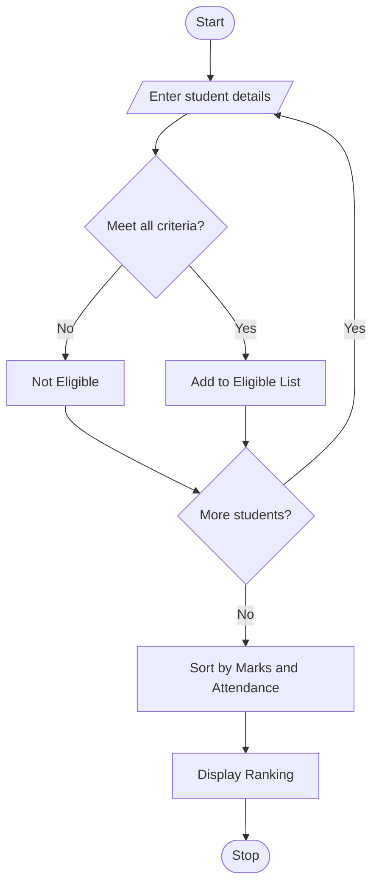

## 1. University Scholarship Allocation

### Problem Statement

To develop a Python program that checks students' marks, subject scores, attendance, and family income to determine scholarship eligibility and rank eligible students.

### Algorithm

1. Start the program.
2. Read student details.
3. Check marks, subject score, attendance, and income.
4. Select eligible students.
5. Rank students by aggregate marks; break ties using attendance.
6. Display the ranking and stop.

### Flowchart

### Sample Input

Number of students: 2
Name: Ravi
Aggregate marks: 85
Minimum subject score: 60
Attendance %: 90
Family income: 150000
Name: Sita
Aggregate marks: 85
Minimum subject score: 55
Attendance %: 95
Family income: 180000

### Sample Output

Scholarship Ranking:
1 Sita Marks: 85.0 Attendance: 95.0
2 Ravi Marks: 85.0 Attendance: 90.0

