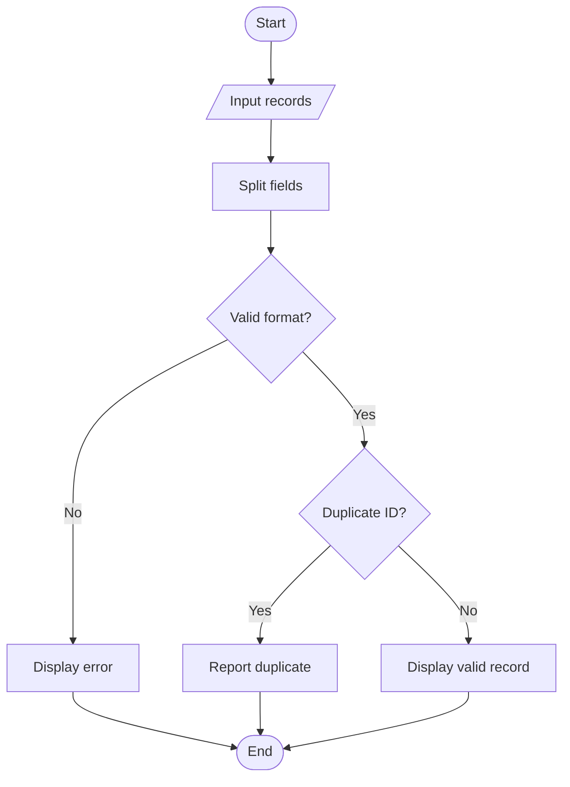

## 91. Advanced String-Based Registration Record Analyzer

### 1. Problem Statement

To validate registration strings, check field formats and lengths, extract details, detect duplicates, and display errors.

### 2. Algorithm

1. Read registration records.
2. Split each record into fields.
3. Validate field lengths and formats.
4. Check duplicate IDs.
5. Display valid records and errors.

### 3. Flowchart 

Format: `ID,Name,Course` — ID must contain 4 characters, and Name must contain only letters.

### 5. Sample Input

A101,Ravi,CSE;A102,Sita,ECE;A101,Ram,EEE;12,John,CSE

### 6. Sample Output

Valid: A101 Ravi CSE
Valid: A102 Sita ECE
A101,Ram,EEE - Duplicate ID
12,John,CSE - Invalid format

