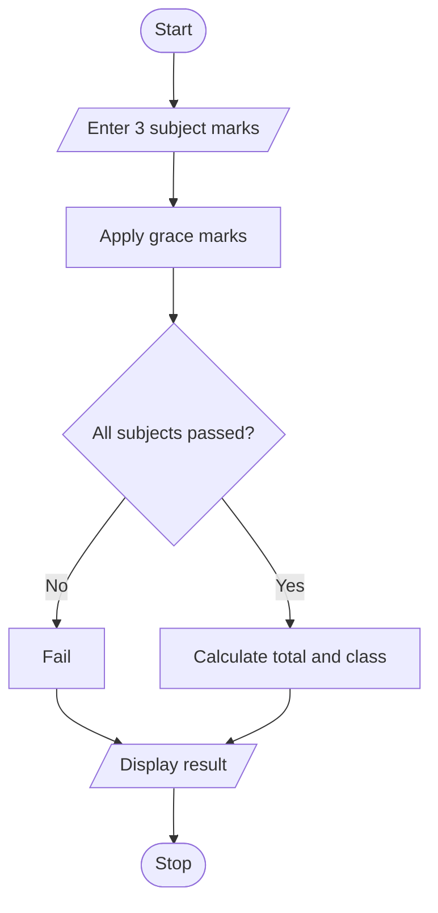

## 11. Examination Result and Grace-Mark Validation

### 1. Problem Statement

To process subject marks, apply grace marks if needed, check pass criteria, and display the final result and classification without exceeding maximum marks.

### 2. Algorithm

1. Read marks of three subjects.
2. Apply grace marks if required.
3. Check pass marks for each subject.
4. Display total, result, and classification.

### 3. Flowchart

### 5. Sample Input

Enter 3 marks: 34 80 90

### 6. Sample Output

Marks: [35, 80, 90]
Total: 205 / 300
Result: First Class

