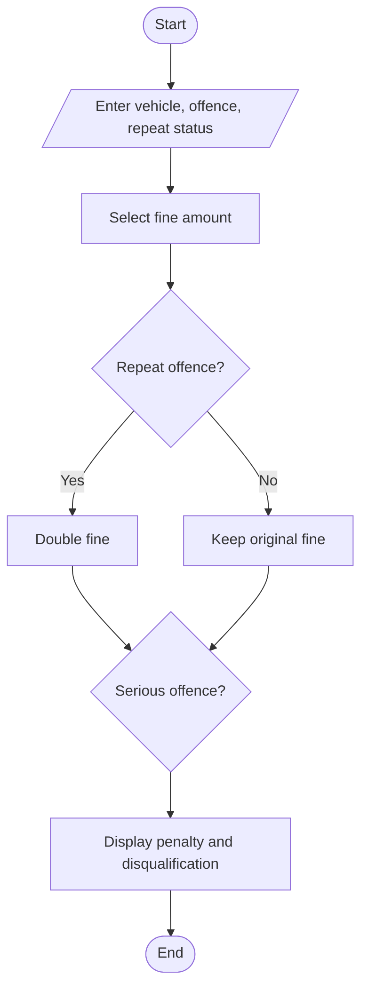

## 21. Traffic Violation Penalty Calculator

### 1. Problem Statement

Calculate traffic fines based on vehicle category, offence type, and repeat offences. Identify whether the driver is disqualified.

### 2. Algorithm

1. Read vehicle category, offence, and repeat status.
2. Select the fine amount.
3. Double the fine for repeat offences.
4. Display the total penalty and disqualification status.

### 3. Flowchart

### 5. Sample Input

Vehicle (Car/Bike/Truck): Car
Offence (Normal/Serious): Serious
Repeat (yes/no): yes

### 6. Sample Output

Penalty: ₹ 2000
Disqualification: Yes

Note: Fine amounts and disqualification rules are illustrative, not official traffic laws.
