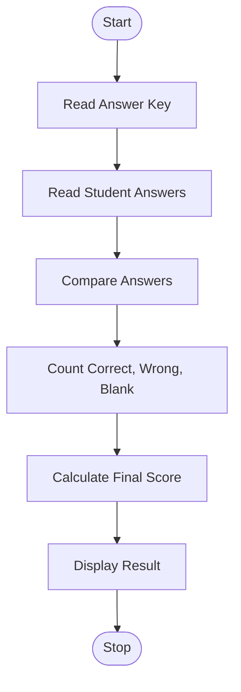

## 31. String-Based Examination Answer Evaluation

### 1. Problem Statement

Compare student answers with the answer key, calculate correct, incorrect, and unanswered responses, apply negative marking, and display the final result.

### 2. Algorithm

1. Start.
2. Read the answer key and student answers.
3. Count correct, incorrect, and unanswered answers.
4. Apply negative marking for incorrect answers.
5. Display the final score.
6. Stop.

### 3. Flowchart 

### 5. Sample Input

Answer key: A B C D
Student answers: A X - D

### 6. Sample Output

Correct: 2 Wrong: 1 Unanswered: 1
Final Score: 1.75

Note: Each correct answer gets +1 mark, each wrong answer gets −0.25 marks, and unanswered questions get 0 marks. Use `-` for an unanswered question.
