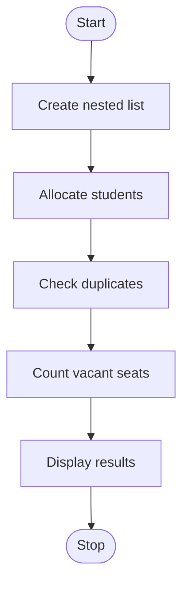

## 41. Nested List Classroom Occupancy Analysis

### 1. Problem Statement

Represent classrooms using nested lists, allocate students, preserve reserved seats, detect duplicate assignments, and calculate vacant seats.

### 2. Algorithm

1. Create a nested list of classroom seats.
2. Allocate students to available seats.
3. Preserve reserved seats.
4. Check duplicate student names.
5. Display vacant seat count.

### 3. Flowchart (Mermaid)

### 5. Sample Input

Classroom 1: Ram, Reserved, Empty
Classroom 2: Sita, Ram, Empty

### 6. Sample Output

Duplicate: True
Vacant seats: 2

