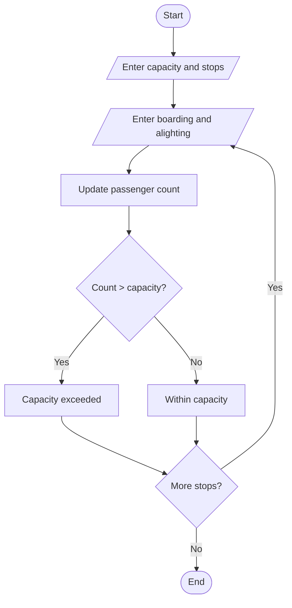

## 51. Bus Passenger Occupancy Simulation

### 1. Problem Statement

To calculate passenger counts at each bus stop using boarding and alighting numbers and check whether bus capacity is exceeded.

### 2. Algorithm

1. Read bus capacity and number of stops.
2. Read boarding and alighting counts.
3. Calculate current passengers.
4. Display passenger count and capacity status.

### 3. Flowchart 

### 5. Sample Input

Bus capacity: 40
Number of stops: 2
Boarding: 20
Alighting: 0
Boarding: 25
Alighting: 5

### 6. Sample Output

Passengers: 20
Within capacity
Passengers: 40
Within capacity

