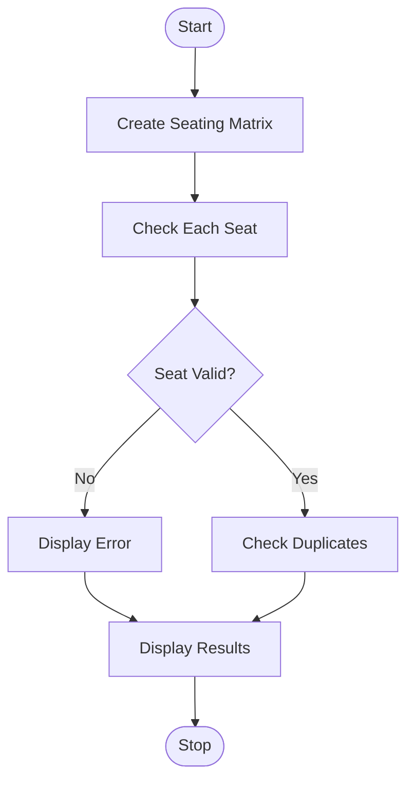

## 61. Nested List Examination Seating Validation

### 1. Problem Statement

Validate the seating matrix for duplicate roll numbers, reserved seats, empty seats, and invalid student allocations.

### 2. Algorithm

1. Store seats in a nested list.
2. Check each seat for reserved, empty, or invalid values.
3. Find duplicate roll numbers.
4. Display the validation results.

### 3. Flowchart (Mermaid)

### 5. Sample Input

Seating Matrix: [[101, 102], [103, 101]]
Reserved seat: (0, 1)

### 6. Sample Output

101 Valid
102 Reserved seat occupied
103 Valid
101 Duplicate roll number

