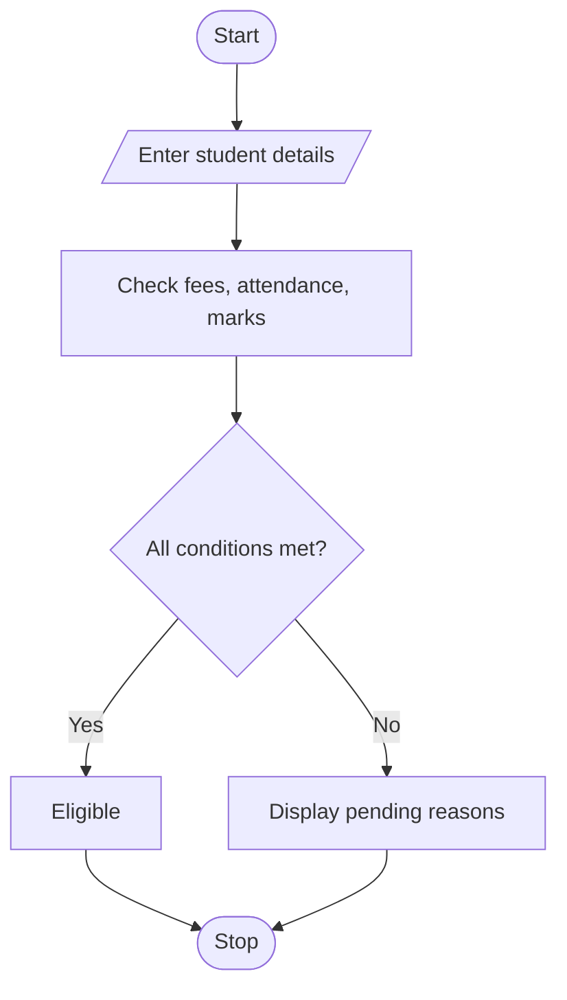

## 71. Integrated University Fee and Eligibility Audit

### 1. Problem Statement

To check students' fee payments, attendance, and internal marks to determine examination eligibility and report pending conditions.

### 2. Algorithm

1. Start.
2. Enter student details.
3. Check fees, attendance, and marks.
4. Display pending conditions or eligibility.
5. Stop.

### 3. Flowchart 

### 5. Sample Input

Number of students: 2
Name: Ravi
Fee pending: 0
Attendance: 85
Internal marks: 25
Name: Sita
Fee pending: 1000
Attendance: 60
Internal marks: 15

### 6. Sample Output

Ravi Eligible
Sita Fee pending, Low attendance, Low marks

