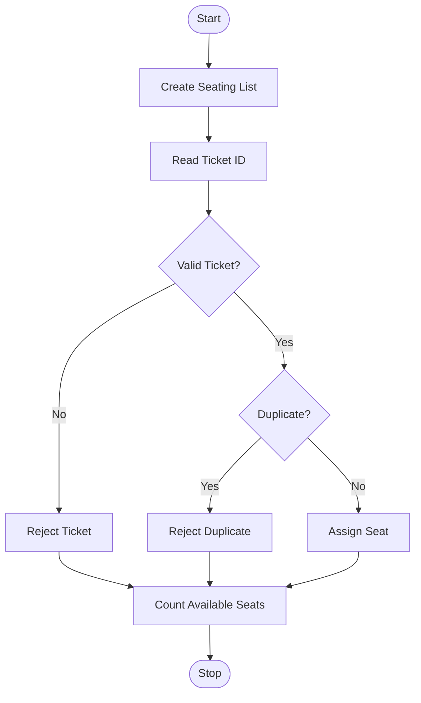

## 81. Campus Event Seating and Entry Validation

### 1. Problem Statement

To assign seats using nested lists, validate tickets, detect duplicate entries, and calculate available seats.

### 2. Algorithm

1. Create a seating list and registration IDs.
2. Read ticket IDs.
3. Check valid and duplicate tickets.
4. Assign seats and count available seats.
5. Display the results.

### 3. Flowchart 

### 5. Sample Input

A1, A2, A1, X1

### 6. Sample Output

A1 Seat assigned
A2 Seat assigned
A1 Duplicate
X1 Invalid
Available seats: 2

